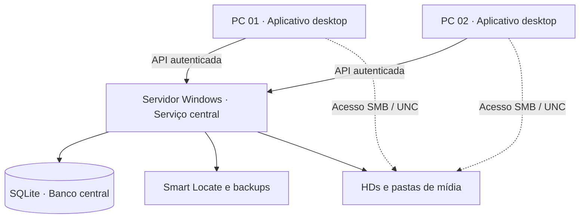

[README (1).md](https://github.com/user-attachments/files/34392656/README.1.md)
<div align="center">

# 🎬 Sistema de Pautas

**Organização, decupagem e localização inteligente de mídias para produções audiovisuais.**

Uma aplicação desktop para transformar pastas de gravação em um acervo pesquisável de **clientes, pautas e takes**, com comentários, favoritos, filtros e recuperação de vínculos de arquivos movidos.


[Funcionalidades](#-funcionalidades) · [Instalação](#-executando-o-projeto) · [Uso em rede](#-arquitetura-cliente-servidor) · [Smart Locate](#-smart-locate) · [Documentação](#-documentação)

</div>

---

## 📖 Visão geral

O **Sistema de Pautas** foi desenvolvido para facilitar o trabalho de quem precisa registrar, revisar e reencontrar gravações distribuídas em diferentes HDs e diretórios. Em vez de depender apenas do nome de um vídeo, a equipe pode organizar o material por pauta e cliente, registrar observações em cada take e recuperar rapidamente cenas relevantes.

A aplicação utiliza **Python** e uma interface desktop em **PySide6**. O armazenamento de dados usa **SQLite**. Além da execução local, o projeto recebeu uma implementação cliente-servidor para uso compartilhado em rede local, cuja instalação definitiva ainda depende da configuração e validação do ambiente real.

## ✨ Funcionalidades

| Área | Recursos |
| --- | --- |
| **Pautas** | Cadastro, edição, consulta, status e organização de pautas audiovisuais. |
| **Clientes** | Nomes digitados livremente, sugestões de nomes existentes e pesquisa parcial sem depender de uma lista fixa. |
| **Takes** | Registro de arquivos associados às pautas, comentários, tags, classificação e marcação de favoritos. |
| **Pesquisa** | Busca por palavras-chave, clientes, datas e combinações de filtros; histórico de pesquisas. |
| **Acervo** | Navegação e consulta de pautas e seus arquivos vinculados. |
| **Exportação** | Exportação dos resultados e informações nos formatos oferecidos pelo sistema, incluindo CSV e JSON. |
| **Smart Locate** | Localização de pastas e mídias movidas, com revisão de correspondências, atualização segura e desfazimento. |
| **Rede local** | Backend centralizado, autenticação, permissões e proteção contra conflitos de edição na implementação mais recente. |

### Fluxo de trabalho

1. **Cadastre uma pauta** e informe o cliente, a data e o diretório do material.
2. **Associe os takes** para manter os arquivos relacionados à gravação.
3. **Faça a decupagem**, registrando comentários, tags e marcações importantes.
4. **Pesquise o acervo** por cliente, assunto, data ou informações dos takes.
5. **Exporte os resultados** ou recupere vínculos quebrados com o Smart Locate.

## 🖥️ Interfaces

O projeto contém diferentes versões de interface, incluindo a versão principal (`ui/`) e a V3 (`ui_v3/`). A interface utilizada depende do ponto de entrada escolhido e da configuração do aplicativo.

> **Capturas de tela:** podem ser adicionadas aqui quando as telas finais da versão em rede estiverem homologadas. Não são incluídas imagens ilustrativas que possam ser confundidas com a interface real.

## 🧠 Smart Locate

O **Smart Locate** foi criado para resolver um problema frequente na pós-produção: arquivos e pastas são reorganizados, mas o cadastro ainda aponta para os caminhos antigos.

Exemplo:

```text
Antes: D:\Gravacoes\Pauta 001\Camera 01\C0001.MP4
Depois: D:\Arquivo\2026\Gravacoes\Pauta 001\Camera 01\C0001.MP4
```

A busca prioriza **prefixos conhecidos, estruturas de pastas e caminhos relativos**, evitando percorrer a unidade inteira para cada arquivo. Quando necessário, executa uma varredura compartilhada e apresenta as correspondências encontradas.

**Como usar:**

1. Abra **Localizar arquivos perdidos** na interface.
2. Selecione a unidade ou a menor pasta raiz que contenha os materiais.
3. Inicie a localização e acompanhe o progresso.
4. Revise os resultados, especialmente os ambíguos ou de menor confiança.
5. Confirme a atualização dos vínculos selecionados.
6. Se necessário, use o histórico para **desfazer a última atualização**.

**Segurança:** a busca não move, copia nem modifica arquivos de mídia. As alterações dos caminhos no banco são transacionais. Correspondências ambíguas exigem revisão; coincidência apenas pelo nome do arquivo não é suficiente para confirmação automática.

Leia os detalhes em [SMART_LOCATE.md](SMART_LOCATE.md).

## 🌐 Arquitetura cliente-servidor

A implementação mais recente foi preparada para uma rede com **dois PCs de trabalho** e **um servidor Windows com os HDs de mídia**.



Nesse modelo:

- O **servidor** concentra o banco, a API, as tarefas de localização e os backups.
- Os **clientes** executam a interface localmente e compartilham as informações pelo serviço central.
- Os **vídeos** continuam nos HDs do servidor; quando configurado, o acesso de mídia ocorre por compartilhamentos Windows (SMB/UNC).
- O arquivo SQLite **não deve ser aberto diretamente pela rede** pelos PCs clientes.

> **Estado da implantação:** conforme o relatório de desenvolvimento, os componentes cliente-servidor e os pacotes Windows foram gerados e passaram por testes automatizados. Ainda é necessário configurar IP, credenciais, compartilhamentos, firewall e validar a reprodução dos vídeos nos computadores reais.

As instruções específicas de implantação estão em [REDE_LOCAL.md](REDE_LOCAL.md), disponível na árvore de desenvolvimento da versão de rede. Publique esse documento junto com o código correspondente.

## 🚀 Executando o projeto

### Pré-requisitos

- Windows, para o ambiente de trabalho e a instalação prevista;
- Python compatível com as dependências do projeto, **somente para executar a partir do código-fonte**;
- Acesso ao diretório de mídias e permissão sobre o local escolhido para o banco;
- Git para clonar o repositório.

### 1. Obter o código

```powershell
git clone https://github.com/matheusmerria-hue/sistema-pautas.git
cd sistema-pautas
```

### 2. Criar um ambiente virtual

```powershell
py -m venv .venv
.\.venv\Scripts\Activate.ps1
python -m pip install --upgrade pip
```

### 3. Instalar as dependências

Na versão atualizada do projeto existe um arquivo de dependências para o cliente:

```powershell
python -m pip install -r requirements-client.txt
```

> Se esse arquivo ainda não estiver presente na branch clonada, a versão de rede ainda não foi publicada integralmente. Utilize a lista de dependências correspondente ao commit que você instalou; não misture arquivos de versões diferentes.

### 4. Executar a versão desktop

Interface principal:

```powershell
python main.py
```

Interface V3:

```powershell
python -m ui_v3
```

**Atenção ao banco:** no código publicado anteriormente, o modo local utiliza `C:\PAUTAS_DB\pautas.db`, definido em `config.py`. Confira a configuração da versão instalada e faça backup antes de executar migrações ou abrir um banco de produção.

### Instalação nos computadores da rede

Para a distribuição multiusuário, **prefira os pacotes Windows gerados para servidor e cliente**, seguindo [REDE_LOCAL.md](REDE_LOCAL.md). O diretório de build informado no ambiente de desenvolvimento é `release-network/`.

**Copie a pasta completa de cada executável, inclusive `_internal`, quando existente.** Não copie somente o arquivo `.exe`. Verifique o endereço do serviço, autenticação, permissão SMB e caminhos de mídia antes de iniciar o uso em produção.

## 🧱 Organização do código

```text
sistema-pautas/
├── assets/icons/             # Recursos visuais
├── ui/                       # Interface desktop principal
├── ui_v2/                    # Versão alternativa da interface
├── ui_v3/                    # Interface V3
├── tests/                    # Testes automatizados
├── main.py                   # Entrada da interface principal
├── client_main.py            # Entrada do cliente (versão de rede)
├── server_service.py         # Serviço do servidor (versão de rede)
├── database.py               # Modelo e operações de persistência
├── smart_locate.py           # Motor de localização de arquivos
├── file_scanner.py           # Varredura/importação de arquivos
├── media_loader.py           # Carregamento de mídia
├── exporter.py               # Exportação
├── config.py                 # Configurações da aplicação
├── SistemaPautas.spec        # Especificação de empacotamento
├── requirements-client.txt   # Dependências do cliente (versão de rede)
├── requirements-server.txt   # Dependências do servidor (versão de rede)
├── MIGRACAO_CLIENTES.md      # Histórico da migração de clientes
├── SMART_LOCATE.md           # Funcionamento do localizador
└── REDE_LOCAL.md             # Instalação e operação em rede
```

> A árvore mostra a organização observada no repositório público e nas capturas do ambiente de desenvolvimento. Alguns arquivos da versão de rede ainda podem não existir na branch remota até sua publicação.

## 🧪 Testes e validação

Para executar os testes automatizados a partir da raiz do projeto:

```powershell
python -B -m unittest discover -s tests -v
```

**Histórico de validação informado pelo desenvolvimento:**

- A etapa de migração para clientes e Smart Locate registrou **32 testes aprovados**.
- A implementação cliente-servidor registrou **49 testes aprovados**, incluindo um teste HTTP com dois clientes, criação e leitura de registros, reinício e backup.

Esses resultados são referentes aos ambientes de desenvolvimento/teste. **Não substituem homologação no servidor e nos dois computadores reais**, especialmente quanto a desempenho dos HDs, permissões de compartilhamento e reprodução de mídia.

## 🔐 Segurança e integridade

- Mantenha o serviço da API restrito à rede local e exija autenticação.
- Não publique bancos `.db`, credenciais, tokens, backups nem materiais de clientes no GitHub.
- Configure permissões SMB apenas para usuários autorizados.
- Faça backup consistente antes de qualquer migração e teste periodicamente a restauração.
- Não execute simultaneamente versões antigas e atualizadas sobre o mesmo banco sem confirmar compatibilidade.
- Não compartilhe o arquivo SQLite como unidade de rede para acesso direto dos clientes.

## 🛠️ Solução de problemas

| Situação | O que verificar |
| --- | --- |
| Cliente não conecta | IP/hostname do servidor, serviço ativo, porta, firewall e credenciais. |
| Pauta aparece, mas vídeo não abre | Compartilhamento SMB, permissões e resolução do caminho UNC no cliente. |
| Arquivos aparecem como indisponíveis | Se a mídia foi movida; utilize Smart Locate e revise os resultados. |
| Busca lenta em HDD | Selecione a menor raiz possível e evite buscas pesadas concorrentes. |
| Banco precisa ser migrado | Preserve uma cópia íntegra e siga o procedimento da versão instalada. |
| Executável falha após ser copiado | Confirme que a pasta completa do pacote, inclusive `_internal`, foi transferida. |

## 📚 Documentação

- [Migração para clientes](MIGRACAO_CLIENTES.md) — mudanças no cadastro, filtros e dados legados.
- [Smart Locate](SMART_LOCATE.md) — estratégia de busca, confiança, segurança e desfazimento.
- [Instalação em rede](REDE_LOCAL.md) — configuração do servidor e dos clientes na versão de rede.

## 📌 Estado do projeto

O sistema está em evolução. A migração para clientes e o Smart Locate estão documentados; a versão cliente-servidor foi implementada no ambiente de desenvolvimento e **permanece pendente de configuração e homologação na rede real**.

O repositório público pode estar atrás da árvore local de desenvolvimento. Para distribuir a versão de rede, publique juntos o **código, as dependências, os scripts e a documentação correspondentes ao mesmo commit**. Mantenha arquivos privados e dados de produção fora do versionamento.

---

<div align="center">

**Sistema de Pautas** · Organização audiovisual, do registro da gravação à recuperação do take.

[Voltar ao início](#-sistema-de-pautas)

</div>
